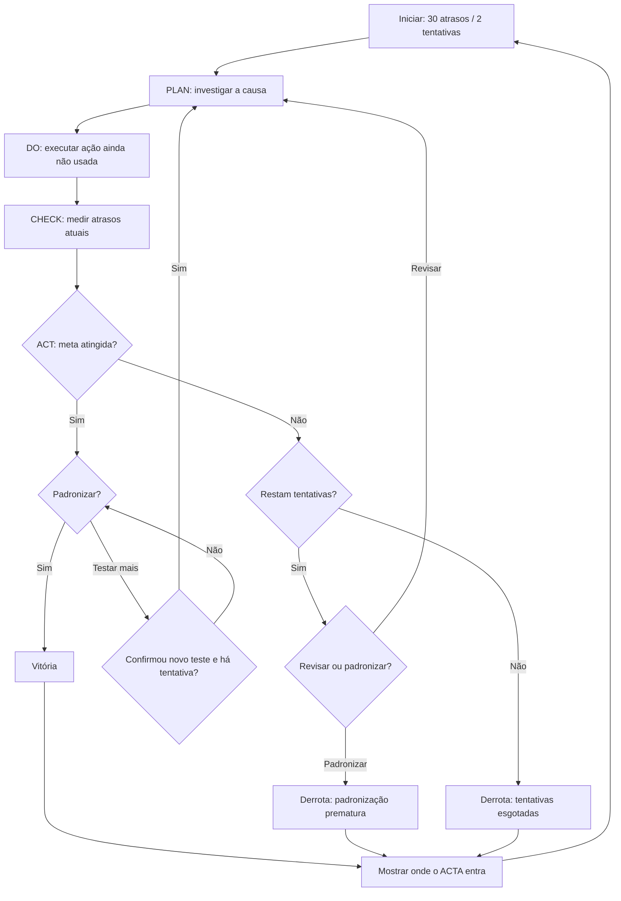

# Motor e estados

> Parte da especificação ACTA Experience. Consulte [o índice](../spec.md) para a visão geral e a ordem de leitura.

## 5. Máquina de estados e regras do motor

### 5.1. Estados da interface

```text
WELCOME
  -> PLAN
  -> DO
  -> CHECK
  -> ACT
      -> PLAN      [revisar, ainda há tentativa]
      -> VICTORY   [meta cumprida + padronização]
      -> DEFEAT    [recursos esgotados ou padronização indevida]
VICTORY -> ACTA_BRIDGE -> WELCOME
DEFEAT  -> ACTA_BRIDGE -> WELCOME
```

**`ACTA_BRIDGE` também pode ser acessada a partir de VICTORY ou DEFEAT**. A conclusão do jogo não pode esconder o propósito do ACTA.

### 5.2. Fluxograma



> **Implementação do ramo “Testar mais uma melhoria” após meta atingida:** confirmar explicitamente; ao confirmar, voltar ao PLAN preservando o progresso, mas sem consumir tentativa até que uma nova ação seja executada. Esconder a opção se `attemptsLeft === 0`.

### 5.3. Modelo de estado em TypeScript

```ts
type Stage =
  | 'welcome'
  | 'plan'
  | 'do'
  | 'check'
  | 'act'
  | 'victory'
  | 'defeat'
  | 'acta-bridge';

type CauseId = 'packaging' | 'shipping' | 'registration';
type ActionId = 'organize-packaging' | 'reinforce-shipping' | 'launch-promotion';
type DefeatReason = 'OUT_OF_ATTEMPTS' | 'PREMATURE_STANDARDIZATION';

type DelayDistribution = Record<CauseId, number>;

type Attempt = {
  number: 1 | 2;
  hypothesis: CauseId;
  actionId: ActionId;
  before: DelayDistribution;
  after: DelayDistribution;
  lateOrdersBefore: number;
  lateOrdersAfter: number;
};

type GameState = {
  stage: Stage;
  totalOrders: 100;
  targetLateOrders: 10;
  delays: DelayDistribution;
  attemptsLeft: number;
  selectedCause: CauseId | null;
  selectedAction: ActionId | null;
  history: Attempt[];
  result: 'victory' | 'defeat' | null;
  defeatReason: DefeatReason | null;
};
```

### 5.4. Modelo do cenário em JSON

```json
{
  "id": "factory-delays-v2",
  "name": "Salve a Fábrica",
  "isSimulated": true,
  "totalOrders": 100,
  "maxAttempts": 2,
  "targetLateOrders": 10,
  "initialDelays": {
    "packaging": 20,
    "shipping": 7,
    "registration": 3
  },
  "actions": [
    {
      "id": "organize-packaging",
      "title": "Reorganizar a embalagem",
      "reduce": { "packaging": 20 }
    },
    {
      "id": "reinforce-shipping",
      "title": "Reforçar a expedição",
      "reduce": { "shipping": 6 }
    },
    {
      "id": "launch-promotion",
      "title": "Lançar uma promoção",
      "reduce": {}
    }
  ]
}
```

### 5.5. Funções de cálculo (exemplo de contrato)

```ts
function totalDelays(delays: DelayDistribution): number {
  return Object.values(delays).reduce((sum, value) => sum + value, 0);
}

function applyAction(
  current: DelayDistribution,
  reductions: Partial<DelayDistribution>
): DelayDistribution {
  return {
    packaging: Math.max(0, current.packaging - (reductions.packaging ?? 0)),
    shipping: Math.max(0, current.shipping - (reductions.shipping ?? 0)),
    registration: Math.max(0, current.registration - (reductions.registration ?? 0)),
  };
}

function reachedTarget(state: GameState): boolean {
  return totalDelays(state.delays) <= state.targetLateOrders;
}
```

As funções são **puras**, fáceis de testar e independentes de React. `applyAction` não decrementa tentativas; essa atualização ocorre em **uma única transição do reducer**, junto à inclusão da ação no histórico.

### 5.6. Eventos do reducer

| Evento | Pré-condição | Efeito |
|---|---|---|
| `START_GAME` | `welcome` | Inicializar partida e entrar em PLAN |
| `SELECT_CAUSE` | `plan` | Registrar hipótese |
| `NEXT_TO_DO` | Hipótese selecionada | Avançar para DO |
| `SELECT_ACTION` | `do`, ação não usada | Registrar ação escolhida |
| `EXECUTE_ACTION` | `do`, ação válida, tentativas > 0 | Aplicar efeito, registrar histórico, consumir 1 tentativa, ir CHECK |
| `NEXT_TO_ACT` | `check` | Mostrar decisão gerencial |
| `REVIEW_PLAN` | `act`, meta não atingida, tentativas > 0 | Voltar a PLAN com atrasos atuais preservados |
| `CONTINUE_AFTER_SUCCESS` | `act`, meta atingida, tentativas > 0, confirmação explícita | Voltar a PLAN preservando resultados sem gastar tentativa |
| `STANDARDIZE` | `act`, meta atingida | Ir para VICTORY e calcular estrelas |
| `STANDARDIZE` | `act`, meta não atingida | Ir para DEFEAT (decisão inadequada) |
| `END_WITHOUT_RESOURCES` | `act`, meta não atingida, tentativas = 0 | Ir para DEFEAT |
| `OPEN_ACTA_BRIDGE` | `victory` ou `defeat` | Mostrar conexão com o produto |
| `RESET_GAME` | Qualquer etapa | Reset completo, inclusive histórico e seleção |

**Invariantes importantes:**

- `0 <= attemptsLeft <= 2`.
- `history.length + attemptsLeft === 2` enquanto a partida estiver ativa ou encerrada.
- Nenhum `actionId` repetido no histórico.
- `totalDelays(delays)` nunca aumenta nem fica negativo neste cenário.
- `victory` exige meta atingida e padronização.
- `defeat` exige `defeatReason` preenchido.
- O jogador não consegue executar duas ações por clique duplo.
- Reiniciar repõe exatamente `20 + 7 + 3`.

### 5.7. Pseudocódigo de resolução da partida

```text
Ao executar uma ação:
  se não há tentativas: bloquear
  se ação já foi usada: bloquear
  salvar contadores anteriores
  aplicar reduções da ação aos contadores atuais
  registrar tentativa no histórico
  decrementar tentativas em 1
  mostrar CHECK

No ACT:
  se atrasos <= 10 e escolheu padronizar: VITÓRIA
  se atrasos > 10 e escolheu padronizar: DERROTA (precipitada)
  se atrasos > 10 e restam tentativas e escolheu revisar: PLAN
  se atrasos > 10 e não restam tentativas: DERROTA (esgotamento)
  se atrasos <= 10 e escolheu testar mais e ainda há tentativa:
    pedir confirmação; se confirmou: PLAN, sem gastar tentativa
  se atrasos <= 10 e não há tentativa: oferecer padronização
```

---
