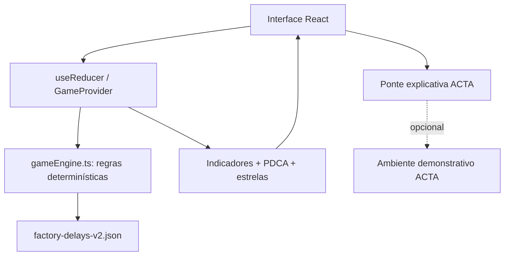

# Requisitos e entrega

> Parte da especificação ACTA Experience. Consulte [o índice](../spec.md) para a visão geral e a ordem de leitura.

## 7. Requisitos funcionais (RF)

| ID | Requisito | Prioridade | Critério de aceite |
|---|---|---|---|
| RF01 | Abrir jogo sem login | P0 | Inicia na tela de desafio sem cadastro. |
| RF02 | Informar vitória e derrota possíveis | P0 | Missão e limite de 2 tentativas são apresentados. |
| RF03 | Identificar a etapa PDCA | P0 | PLAN/DO/CHECK/ACT ativo sempre visível. |
| RF04 | Escolher hipótese em PLAN | P0 | Apenas uma hipótese por rodada. |
| RF05 | Escolher intervenção em DO | P0 | Ações usadas ficam indisponíveis. |
| RF06 | Executar intervenção com custo de tentativa | P0 | 1 clique válido consome exatamente 1 tentativa. |
| RF07 | Acumular efeitos entre rodadas | P0 | Expedição + embalagem produz 4 atrasos. |
| RF08 | Comparar antes/depois | P0 | Números, porcentagem e meta corretos. |
| RF09 | Permitir revisão de plano | P0 | Se meta não cumprida e houver recurso, retorna ao PLAN. |
| RF10 | Permitir decisão de padronização | P0 | ACT produz vitória ou derrota segundo a regra. |
| RF11 | Encerrar por esgotamento | P0 | Se 2 tentativas gastas e meta não cumprida, derrota. |
| RF12 | Exibir tela de vitória | P0 | Resultado, estrelas e motivo de sucesso. |
| RF13 | Exibir tela de derrota | P0 | Motivo de falha e opção de revanche. |
| RF14 | Explicar função do ACTA | P0 | Ponte jogo → problemas, ações, tarefas e indicadores. |
| RF15 | Reiniciar jogo | P0 | Apaga tentativas, histórico e dados alterados. |
| RF16 | Funcionar offline | P0 | Fluxo completo disponível sem rede após preparação. |
| RF17 | Exibir falas contextuais do CATO | P1 | Mensagens curtas e corretas para cada etapa. |
| RF18 | Animação de execução pulável | P1 | Simulação não exige esperar animação. |
| RF19 | Calcular estrelas | P1 | 3, 2, 1 ou 0 segundo regras determinísticas. |
| RF20 | Adicionar cenários futuramente | P2 | Dados externos de cenário sem reescrever UI. |
| RF21 | Linkar ambiente real do ACTA | P2 | Somente com destino configurado e disponível. |

**P0:** obrigatório. **P1:** desejável. **P2:** evolução.

---

## 8. Requisitos não funcionais (RNF)

| ID | Categoria | Diretriz |
|---|---|---|
| RNF01 | Velocidade | Reação instantânea ao clique; animações curtas. |
| RNF02 | Confiabilidade | Nenhuma dependência de API ou autenticação no fluxo principal. |
| RNF03 | Offline | Preparar PWA em cache ou servir todo o build localmente. |
| RNF04 | Compatibilidade | Navegadores modernos, desktop e tablet. |
| RNF05 | Precisão | Contadores, metas, rodadas e estrelas calculados em uma fonte de verdade. |
| RNF06 | Transparência | “Dados simulados” sempre identificável. |
| RNF07 | Segurança | Sem tokens secretos, dados reais ou credenciais no bundle. |
| RNF08 | Recuperação | Reset de um clique; recarregar a página retorna ao estado seguro. |
| RNF09 | Manutenibilidade | Regras em motor puro, cenário em JSON, UI desacoplada. |
| RNF10 | Acessibilidade | Teclado, foco, contraste e movimento reduzido. |

---

## 9. Stack e arquitetura

### 9.1. Stack recomendada

| Tecnologia | Papel | Obrigatório? |
|---|---|---|
| React + TypeScript | UI e modelos tipados | Sim |
| Vite | Desenvolvimento e build | Sim |
| Tailwind CSS | Layout e estilos | Recomendado |
| Context + `useReducer` | Máquina de estado do jogo | Recomendado |
| Motion | Animações curtas de teste e resultado | Opcional |
| Recharts ou SVG/CSS | Comparação visual de indicadores | Opcional; SVG/CSS basta no MVP |
| Lucide React | Ícones do PDCA | Opcional |
| Vitest | Testes de regras e cálculos | Recomendado |
| React Testing Library | Testes de transição/UI | Recomendado |
| Vite PWA | Cache de assets para operação offline | Recomendado |
| Hospedagem estática | Acesso por URL | Opcional para uso local |

**Decisão:** evitar backend no MVP. Uma simulação com três ações, duas tentativas e uma máquina de estados não justifica microsserviços ou banco de dados.

### 9.2. Diagrama de componentes



### 9.3. Organização sugerida

```text
acta-experience/
├── public/
│   └── cato/
├── src/
│   ├── app/
│   │   └── App.tsx
│   ├── components/
│   │   ├── CatoGuide.tsx
│   │   ├── PDCAProgress.tsx
│   │   ├── AttemptsIndicator.tsx
│   │   ├── DecisionCard.tsx
│   │   ├── DelayChart.tsx
│   │   ├── ResultComparison.tsx
│   │   └── ACTABridge.tsx
│   ├── features/game/
│   │   ├── GamePage.tsx
│   │   ├── GameProvider.tsx
│   │   ├── gameReducer.ts
│   │   ├── gameEngine.ts
│   │   ├── scoring.ts
│   │   ├── types.ts
│   │   └── __tests__/
│   │       ├── gameEngine.test.ts
│   │       └── gameReducer.test.ts
│   ├── scenarios/
│   │   └── factory-delays-v2.json
│   ├── services/
│   │   └── actaApi.ts            # apenas integração futura
│   ├── styles/
│   │   └── globals.css
│   └── main.tsx
├── package.json
├── vite.config.ts
└── README.md
```

### 9.4. Roteamento

Uma SPA sem rotas complexas é suficiente. Uma rota pública `/experience` pode integrar-se ao ACTA Web mais adiante. Na feira, abrir diretamente a experiência e guardar todo o estado em memória; **não persistir partidas entre visitantes**.

---

## 10. Integração com o ecossistema ACTA

### 10.1. MVP: sem APIs no jogo

A experiência explica PDCA e o propósito do ACTA por meio de uma **simulação educativa**. Não deve gravar um PDCA fictício em banco de produção.

| Serviço | Função no ACTA | Relação com o minijogo |
|---|---|---|
| `acta-pg-api` | Ciclos, problemas, tarefas, metas, planos e verificações | Integração futura com demo autenticada |
| `acta-auth-api` | Login, identidade, autorização via Firebase | Necessária apenas para acesso real às rotas protegidas |
| `acta-ai` | Assistente gerencial e ferramentas de IA | Não usar no caminho crítico da feira |
| `acta-mcp` | Ferramentas para integrações/agentes | Não necessário no MVP |
| `acta-ts-web` | Base web React/Vite/TypeScript do ACTA | Possível local definitivo da experiência |

### 10.2. Integração real opcional

Depois do resultado, o apresentador pode abrir a plataforma real num ambiente preparado, com um ciclo de exemplo. Rotas documentadas no README da PG API incluem:

```http
GET /ciclo
GET /ciclo/{id}
GET /ciclo/{idCiclo}/plano-acao
GET /ciclos/{idCiclo}/verificacoes
```

Essas operações exigem autenticação Firebase nas rotas protegidas. Validar contratos, permissões, CORS e endereços no Swagger da implantação real. **Nunca armazenar token de serviço no front-end público**.

### 10.3. Mensagem da ponte com o ACTA

**ACTA não é o jogo.** O jogo representa, em poucos cliques, um ciclo que em empresas reais exige:

- Registro de problemas e investigação de causas.
- Plano de ação com responsáveis e prazos.
- Execução e acompanhamento das tarefas.
- Verificação de resultados e acompanhamento de metas.
- Padronização de práticas eficazes e aprendizado contínuo.

Essas necessidades explicam o valor da plataforma com mais clareza do que começar a apresentação pelas telas de login e cadastro.

---

## 11. Roteiro da feira

### 11.1. Pitch de abertura: 10 segundos

> “Você é o gestor dessa fábrica: 30 de 100 pedidos estão atrasados. Sua missão é reduzir para 10 ou menos usando só duas tentativas. Se não conseguir, perdeu. Bora tentar?”

### 11.2. Roteiro de 60–90 segundos

| Tempo-alvo | Ação | Fala possível |
|---|---|---|
| 0–10s | Mostrar missão e duas tentativas | “Você consegue salvar a fábrica?” |
| 10–25s | PLAN | “Veja onde se concentram os atrasos. Qual causa você investigaria?” |
| 25–40s | DO | “Agora escolha uma ação. Cada teste gasta uma tentativa.” |
| 40–55s | CHECK | “Antes eram 30 atrasos. Quantos ficaram depois do teste?” |
| 55–70s | ACT | “A meta foi alcançada? Você padronizaria ou revisaria a estratégia?” |
| 70–90s | Vitória/derrota e ponte ACTA | “No jogo é simples; o ACTA organiza isso com equipes, tarefas e metas de verdade.” |

Uma segunda rodada pode alongar a apresentação. O aplicativo deve permitir **pular animações** e o apresentador pode resumir o texto oralmente. Os tempos são **metas de design**, sujeitos a teste real com visitantes.

### 11.3. Se o jogador ganhar

> “Você fez o PDCA completo: olhou os dados, planejou, executou, verificou a meta e tomou uma decisão para manter a melhoria. O ACTA ajuda a controlar isso com equipes e processos reais.”

### 11.4. Se o jogador perder

> “Percebeu que fazer alguma coisa não significa resolver o problema? O PDCA serve justamente para testar, verificar e corrigir. E o ACTA ajuda a registrar essas decisões e acompanhar os resultados.”

**Não tentar forçar vitória de todos os visitantes.** A derrota é um gancho natural para explicar o valor do CHECK e do ACT.

### 11.5. Fluxo rápido para público com pressa

- Apresentar missão, meta e tentativas.
- Visitante escolhe causa e intervenção.
- Mostrar indicador e decisão ACT.
- Mostrar o resultado e a frase de conexão ao ACTA.

---

## 12. Plano de desenvolvimento

| Fase | Entrega | Definição de pronto |
|---|---|---|
| 1. Fundação | React/Vite/TS, tela de desafio e dados locais | O jogo abre e é legível num monitor da feira |
| 2. Motor | Ações, distribuição, 2 tentativas e histórico | Todas as combinações dão resultados corretos |
| 3. Fluxo PDCA | PLAN → DO → CHECK → ACT | Jogador consegue percorrer todas as etapas |
| 4. Vitória e derrota | Encerramentos, motivo e revanche | Condições funcionam sem ambiguidades |
| 5. Visual | CATO, barras, estrelas, animações curtas | Feedback é compreensível sem explicação extensa |
| 6. Conexão ao produto | Tela “Onde o ACTA entra?” | Apresentação liga jogo ao sistema real |
| 7. Robustez | Offline, reset, acessibilidade e testes | Uso repetido não causa travamento |
| 8. Ensaio | Testar com pessoas que não conhecem PDCA | Público entende objetivo, derrota e vitória |

### 12.1. O que **não** desenvolver antes da feira

- Login dos visitantes e cadastro de jogadores.
- Ranking online ou coleta de nomes.
- Dinheiro virtual sofisticado, inventário, upgrades ou dificuldade adaptativa.
- Animações longas e cutscenes.
- Dependência de IA generativa para explicar o PDCA.
- Salvamento de cada partida no PostgreSQL ou MongoDB.
- Vários cenários antes de validar o primeiro.

**O objetivo é um minijogo funcional, não outro produto inteiro.**

---

## 13. Plano de testes

### 13.1. Testes unitários obrigatórios

| Cenário | Resultado esperado |
|---|---|
| Estado inicial | `20 + 7 + 3 = 30`, 2 tentativas |
| Embalagem primeiro | `0 + 7 + 3 = 10`, 1 tentativa restante |
| Expedição primeiro | `20 + 1 + 3 = 24`, 1 tentativa restante |
| Promoção primeiro | `20 + 7 + 3 = 30`, 1 tentativa restante |
| Expedição + embalagem | `0 + 1 + 3 = 4`, 0 tentativas restantes |
| Promoção + embalagem | `0 + 7 + 3 = 10`, 0 tentativas restantes |
| Expedição + promoção | `20 + 1 + 3 = 24`, 0 tentativas restantes |
| Promoção + expedição | `20 + 1 + 3 = 24`, 0 tentativas restantes |
| Padronizar com 10 | Vitória |
| Padronizar com 24 e 1 tentativa | Derrota prematura |
| Esgotar 2 tentativas com 24 | Derrota por recursos |
| Revisar com 1 tentativa restante | Retornar a PLAN e preservar 24 |
| Clicar DO duas vezes rapidamente | Somente 1 intervenção executada |
| Repetir ação já executada | Ação bloqueada |
| Reiniciar | Estado, histórico e estrelas zerados |
| Selecionar causa errada, ação correta | Resultado de intervenção correto; sem punição matemática |

### 13.2. Testes de interface

- A seleção de opções é legível em monitor/projetor.
- O limite de tentativas nunca desaparece.
- O resultado aponta a diferença entre redução em **pontos percentuais** e redução relativa.
- O CATO não cobre botões.
- Animações podem ser puladas sem modificar o cálculo.
- A navegação por teclado conclui uma partida.
- O botão reset volta ao estado seguro em qualquer etapa.
- Sem conexão, a experiência permanece utilizável depois de preparada.
- Recarregar a página não reaproveita as escolhas de um visitante anterior.

### 13.3. Testes de apresentação

Realizar pelo menos alguns ensaios com pessoas que não conhecem o ACTA. Observar:

- A missão foi entendida sem explicações longas?
- A pessoa percebeu que só tem duas tentativas?
- Entendeu por que ganhou ou perdeu?
- Conseguiu explicar, mesmo que resumidamente, PLAN, DO, CHECK e ACT?
- Entendeu que o ACTA real **não é o jogo**, mas uma plataforma de gestão?

---

## 14. Riscos e cuidados

| Risco | Mitigação |
|---|---|
| Jogo parecer quiz de alternativas | Mostrar impacto visual e evolução dos indicadores após cada ação. |
| Derrota parecer punição arbitrária | Explicar a meta, o limite e as consequências antes de decidir. |
| Solução ideal parecer óbvia | Não esconder evidências: aprender a priorizar é o objetivo, não uma pegadinha. |
| Visitante errar a hipótese de PLAN | Não interferir artificialmente no resultado da ação; usar feedback educativo. |
| Jogo demorar demais | Uma pergunta por etapa, máximo duas intervenções e animações puláveis. |
| Confundir simulação com dados reais | Selo “Dados simulados” durante toda a experiência. |
| Internet falhar | PWA preparado ou build servido localmente. |
| Backend falhar | Nenhum backend necessário para a partida. |
| App se tornar maior que o ACTA | Preservar foco em mostrar o método e a ponte ao sistema real. |
| Equipe gastar tempo em recursos cosméticos | Motor, interface legível e encerramentos vêm primeiro. |

---

## 15. Critérios de aceite do MVP

- [ ] O jogador entende que pode **ganhar ou perder**.
- [ ] A meta de **até 10 atrasos em 100 pedidos** é clara.
- [ ] O jogo começa com **2 tentativas**.
- [ ] Cada intervenção executada gasta exatamente uma tentativa.
- [ ] A tela exibe dados de embalagem, expedição e cadastro.
- [ ] PLAN registra a hipótese escolhida.
- [ ] DO impede ação repetida e calcula o efeito correto.
- [ ] CHECK compara o valor inicial, o atual e a meta.
- [ ] ACT permite padronizar ou revisar conforme o contexto.
- [ ] A vitória exige meta atingida e padronização.
- [ ] A derrota acontece por esgotamento ou padronização precipitada.
- [ ] A tela final mostra resultados e causa da vitória/derrota.
- [ ] Existe botão de revanche e de reinício para o próximo visitante.
- [ ] O conteúdo explica os recursos reais do ACTA.
- [ ] O CATO tem falas curtas e contextuais.
- [ ] É possível operar sem internet após preparar a aplicação.
- [ ] Não há login, tokens embutidos nem dados reais de visitantes.
- [ ] A apresentação completa cabe numa interação curta com o público.

---

## 16. Evoluções futuras (fora do MVP)

1. **Cenários adicionais:** restaurante com demora no atendimento, loja com estoque desorganizado, escola com retrabalho de documentos.
2. **Três níveis:** tutorial, normal e difícil, com diferentes metas e tentativas.
3. **Modo desafio entre visitantes:** placar apenas em memória da sessão local, se houver interesse.
4. **Tela comparativa do ACTA real:** abrir um ciclo de exemplo já preparado e autenticado.
5. **Relatório ilustrativo:** um resumo de decisões com 5W2H e indicadores, sem persistir na produção.
6. **Modo apresentação:** tipografia maior, fluxo guiado e atalhos do apresentador.

A evolução deve ocorrer somente se o teste na feira demonstrar valor e a equipe tiver disponibilidade. A prioridade é **ACTA**, não criar um segundo sistema de gestão.

---

## 17. Decisões finais da equipe

| Pergunta | Decisão |
|---|---|
| Formato | Minijogo web “Salve a Fábrica” |
| Tecnologias | React + TypeScript + Vite |
| Precisa de backend? | **Não no MVP** |
| Precisa de IA? | **Não no MVP** |
| Tem vitória e derrota? | **Sim, condições explícitas** |
| Quantas tentativas? | **Duas** |
| Resultados aleatórios? | **Não, determinísticos** |
| Ganhar depende de quê? | Atingir `<= 10` atrasos e padronizar a melhoria |
| Perder depende de quê? | Gastar 2 tentativas sem meta ou padronizar antes da hora |
| Pontuação | 0–3 estrelas, sem ranking |
| Reinício | Imediato, sem salvar dados pessoais |
| Meta da feira | Ensinar PDCA e justificar o papel do ACTA em 60–90s |

---

## 18. Referências técnicas do ecossistema

- [ACTA Web — acta-ts-web](https://github.com/AppActa/acta-ts-web)
- [ACTA PG API — acta-pg-api](https://github.com/AppActa/acta-pg-api)
- [ACTA Auth API — acta-auth-api](https://github.com/AppActa/acta-auth-api)
- [ACTA AI — acta-ai](https://github.com/AppActa/acta-ai)
- [ACTA MCP — acta-mcp](https://github.com/AppActa/acta-mcp)

**Observação:** verificar os contratos de API no Swagger e a versão implantada antes de uma integração real. Os dados e impactos do jogo são material educativo fictício.

---
